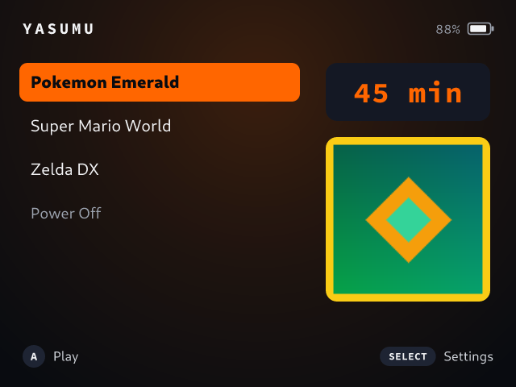
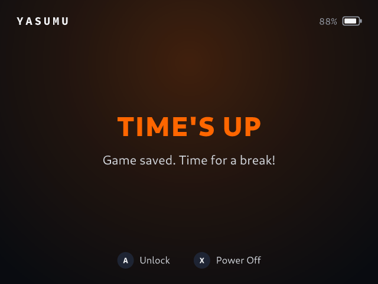
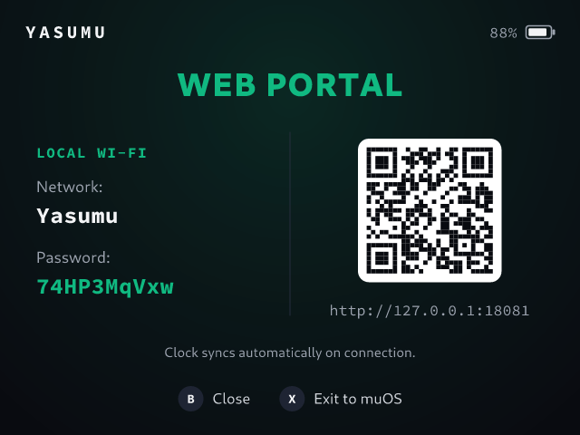
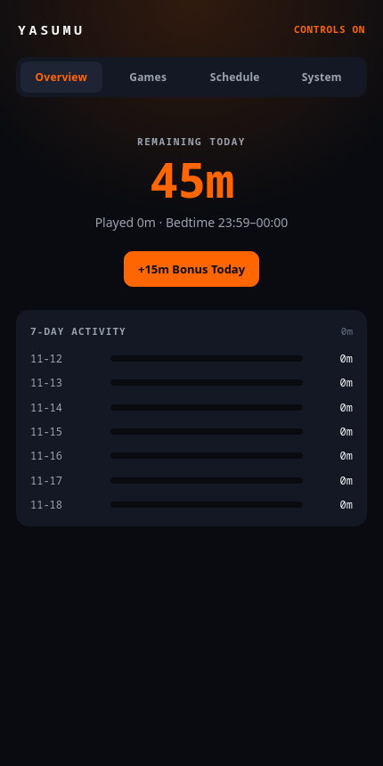
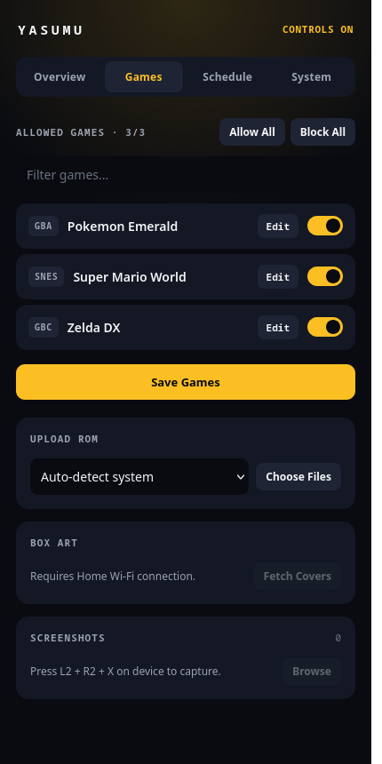
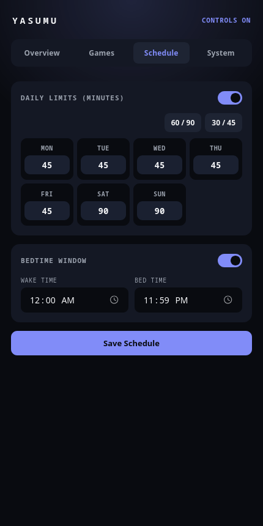

# yasumuOS

> **Minimalist launcher with Switch-style parental controls for retro emulation handhelds.**

Built for **640×480 Wi-Fi handhelds** running **MustardOS (muOS)** (Anbernic H700 family: RG35XXSP, RG35XX Plus, RG35XX H, RG40XX H, RG40XX V — tested on RG35XXSP). *yasumu* (休む) — take a break.

| Launcher | Time's Up | Web Portal (On-Device QR) |
| :---: | :---: | :---: |
|  |  |  |

| Overview | Games | Schedule |
| :---: | :---: | :---: |
|  |  |  |

## What It Does

- **Daily quotas, bedtime & stats** — Per-day minute limits (0–240 min, or disabled), wake/bed hours, 7-day activity chart, and most-played game ranking.
- **Graceful game exit** — 5-minute and 1-minute on-screen warnings with soft audio chimes, followed by an automatic RetroArch save-state and clean exit when time runs out.
- **Phone Web Portal** — PIN-gated (`SELECT` on device). Connects over Home Wi-Fi or spins up a local `Yasumu` hotspot with QR codes when offline.
- **Games, ROM uploads & box art** — Allowlist games, edit titles, upload new ROMs over Wi-Fi (auto-detecting system folders), and fetch missing Libretro box art.
- **Screenshot manager** — Paginated gallery to browse, download, and delete on-device screenshots (`L2 + R2 + X`) without removing the SD card.
- **Tamper-resistant** — HMAC-signed config/usage state, RTC rollback detection (fails closed until clock is synced from a phone), and locked-down RetroArch hotkeys.
- **6 languages** — English, Français, Español, Deutsch, 日本語, 简体中文 (synced across launcher, portal, and RetroArch).

## Install

Requires **MustardOS (muOS 2606.0+)** on a compatible 640×480 Wi-Fi ARM64 handheld (tested on Anbernic RG35XXSP).

1. Download `yasumuOS.muxapp` from [Releases](https://github.com/t0mg/yasumuOS/releases/latest) and copy it to `ARCHIVE/` on your SD card.
2. On the handheld, open **Archive Manager** and extract `yasumuOS.muxapp`.
3. Open **Applications → yasumuOS** to install and reboot into yasumuOS.

On first boot, the launcher opens the Web Portal automatically — scan the QR code from your phone to set a 4-digit PIN and allow your first games.

> **Temporarily use stock muOS**: Open the Web Portal → **System → Exit to Standard muOS (1 Session)** (returns to yasumuOS on next reboot).

## Uninstall

Open the Web Portal → **System → Uninstall yasumuOS**.

This restores the original muOS frontend and boot splash, removes `/opt/yasumu`, and reboots automatically. Your ROMs, saves, and box art are untouched.

## Build from Source

```sh
# Native x86_64 unit + headless SDL2 end-to-end tests
cargo test

# Cross-compile ARM64 binary and package dist/yasumuOS.muxapp (requires Podman or Docker)
./scripts/build-arm64.sh
```

---

*Nintendo Switch is a trademark of Nintendo. yasumuOS is an independent project and is not affiliated with Nintendo.*
